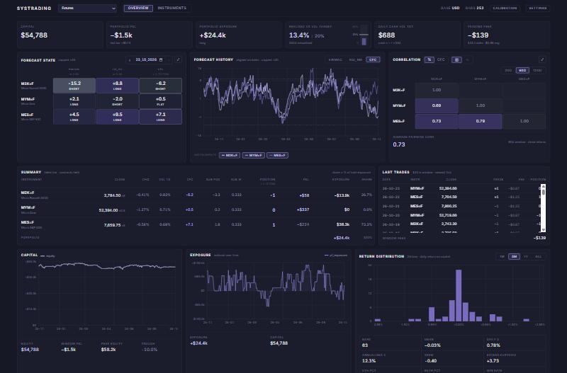
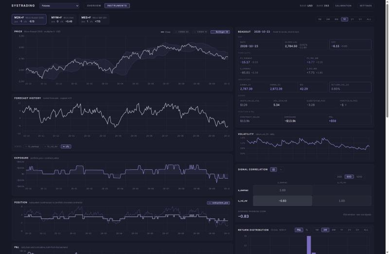
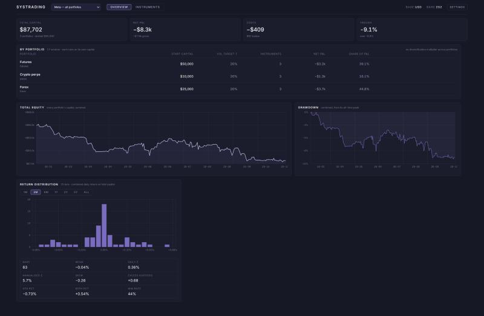

# Systrading

A systematic trading framework built on Robert Carver's *Systematic Trading*, with a
React dashboard on top. Python does every calculation; the frontend only displays what
the backend sends.



## What it does

Each **portfolio** is a complete, independent Carver system with its own capital,
volatility target, calendar and instruments. They don't know about each other — a meta
view adds them up afterwards for reporting and changes nothing.

The position chain, per instrument per bar:

```
raw signal        per rule, price-scaled only where the signal carries price units
forecast          raw × scalar, capped at ±20
combined          Σ(forecast × weight) × FDM
daily cash vol    capital × τ / √(bars per year)
instrument vol    price volatility × contract value
vol scalar        daily cash vol ÷ instrument vol
subsystem pos     combined ÷ 10 × vol scalar
portfolio pos     subsystem × instrument weight × IDM, rounded to the instrument's step
```

Costs are real — half the estimated spread plus per-ticket, per-unit and percentage fees
— and they come out of capital, so they feed back into the next bar's position sizing.

The dashboard also reports Carver's speed-and-size diagnostics per instrument:
standardised cost in Sharpe-ratio units, turnover in round trips per year, the implied
annual cost against his 0.13 speed limit, and the maximum possible position in blocks.
Those are read-only — nothing in the simulation acts on them.

## Running it

```bash
cd framework && python run.py      # downloads data, builds, serves on :8765
cd frontend  && npm run dev        # dashboard
```

On first run there's no `config.json`, so the dashboard opens a setup form instead of the
dashboard. Accept the defaults or edit them; saving writes the file and runs the
simulation. After that, **Settings** in the top right edits the configuration and
rebuilds, and portfolios can be added or removed there.

Requires `pandas`, `numpy`, `yfinance`, `flask`, and Node for the frontend.

## Layout

```
framework/
  settings.py        config file + its projection into module constants
  download.py        yfinance
  indicators.py      EWMA, volatility, RSI, Bollinger, drawdown
  rules.py           raw trading signals
  forecasts.py       scaling, capping, combining
  position_sizing.py vol scalar, subsystem and portfolio position, cost, P&L
  calibration.py     forecast scalars, weights, diversification multipliers
  correlations.py    rolling correlation histories
  reporting.py       stats, distributions, cost diagnostics, meta aggregation
  run.py             the simulation loop, one pass per portfolio
  webserver.py       Flask: /api/results, /api/config
frontend/src/
  Terminal.jsx       the only fetches in the app
  views/             Overview, Instruments, Meta, Config, Nav
```

## Instruments tab



Per-instrument price with overlays, forecast history, exposure, position, P&L, a readout
of every intermediate value on the selected bar, and the raw dataframe. Clicking a chart
locks the bar so the readout stays put.

## Meta view



Every portfolio summed on a union calendar — days a portfolio doesn't trade contribute no
P&L and carry their capital forward. Reporting only: there is deliberately no
diversification multiplier across portfolios.

## Placeholders

Known gaps, left deliberately:

- **Forecast scalars** are fitted on one instrument per portfolio rather than bootstrapped.
- **Exchange rates** return 1. Fine while everything settles in USD, not otherwise.
- **Funding** on perpetuals is not modelled. Costs are trading costs only, so a
  long-biased crypto book will look better than it is.
- Nothing is validated. A bad configuration fails the rebuild and rolls back to the
  previous one; the error shows in the settings form.
